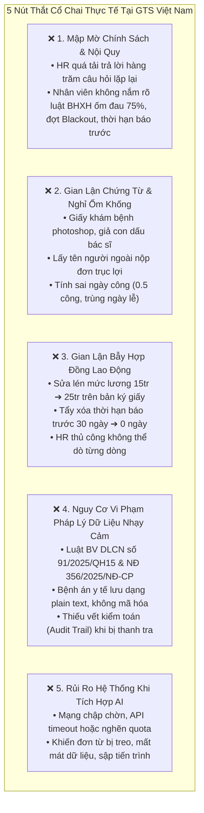
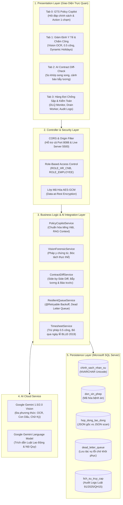
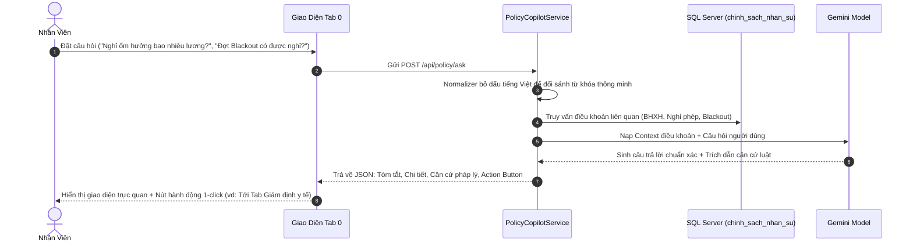
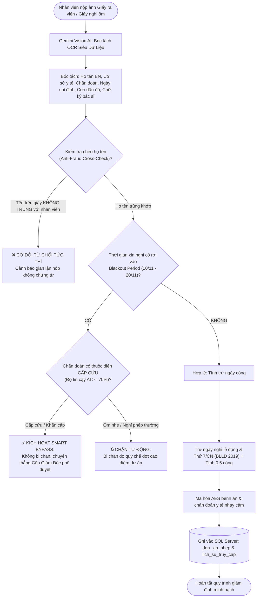
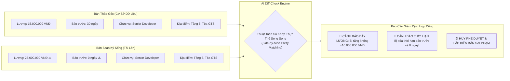
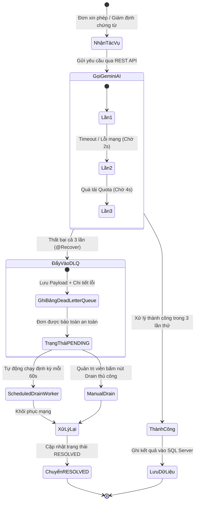

# BÁO CÁO PHÂN TÍCH VẤN ĐỀ DOANH NGHIỆP & KIẾN TRÚC GIẢI PHÁP GTS HRM (AI BUILDATHON 2026)

---

## I. BỐI CẢNH DOANH NGHIỆP & 5 ĐIỂM NGHẼN CỐT LÕI (PROBLEM STATEMENTS)

**GTS Việt Nam** là doanh nghiệp công nghệ & vận hành quy mô đang mở rộng nhanh. Khảo sát thực tế nghiệp vụ quản trị nhân sự và hành chính tại GTS cho thấy **5 "nút thắt cổ chai" mang tính rủi ro tài chính và pháp lý cao** mà các phần mềm HRM truyền thống không giải quyết được:

---

## II. SƠ ĐỒ KIẾN TRÚC TỔNG THỂ HỆ THỐNG (ENTERPRISE ARCHITECTURE)

Hệ thống được thiết kế theo mô hình **Multi-Layer Enterprise Architecture** khép kín, kết hợp sức mạnh xử lý của Spring Boot 3, cơ sở dữ liệu Microsoft SQL Server 2022, mô hình đa phương thức Google Gemini AI và lớp bảo vệ dữ liệu chuẩn pháp chế Việt Nam.

---

## III. SƠ ĐỒ CHI TIẾT 4 PHÂN HỆ GIẢI QUYẾT BÀI TOÁN

### 1. Phân Hệ 1: Cổng Tra Cứu Quy Chế & Nội Quy (GTS Policy Copilot)
* **Giải quyết Vấn đề 1:** Giải phóng 90% thời gian của phòng Nhân sự. Trả lời chính xác từng điều khoản, trích dẫn văn bản pháp luật hiện hành và cung cấp nút bấm thao tác 1-chạm đưa nhân viên tới đúng nghiệp vụ.

---

### 2. Phân Hệ 2: Giám Định Chứng Từ Y Tế & Chống Gian Lận Đơn Từ (Forensic AI & Anti-Fraud)
* **Giải quyết Vấn đề 2 & Vấn đề 4:** Phát hiện con dấu giả, chữ ký bác sĩ, kiểm tra chéo tên người nộp với hồ sơ nhân sự công ty, tự động kích hoạt **Smart Bypass** trong đợt Blackout và mã hóa bệnh án theo **Luật BV DLCN số 91/2025/QH15 & NĐ 356/2025/NĐ-CP**.

---

### 3. Phân Hệ 3: AI Contract Diff-Check (So Khớp Chống Sửa Lén Hợp Đồng)
* **Giải quyết Vấn đề 3:** Ngăn chặn tuyệt đối việc nhân viên hoặc đối tác sửa lén điều khoản bất lợi trước khi ký tay và nộp lại bản scan.

---

### 4. Phân Hệ 4: Hàng Đợi Chống Sập & Khôi Phục Sự Cố (Dead Letter Queue - DLQ)
* **Giải quyết Vấn đề 5:** Bảo đảm nguyên tắc **Zero Data Loss** (Không bao giờ mất đơn của nhân viên), hệ thống tự phục hồi tự động khi API AI gặp sự cố mạng hoặc nghẽn quota.

---

## IV. MA TRẬN ĐỐI CHIẾU 5 TIÊU CHÍ BÀI TOÁN AI BUILDATHON 2026

| STT | Bài toán gợi ý từ Ban Tổ Chức | Phân hệ giải quyết trong GTS HRM | Điểm kỹ thuật & Nghiệp vụ nổi bật |
| :---: | :--- | :--- | :--- |
| **01** | **Tra cứu chính sách nhân sự** | **Tab 0: GTS Policy Copilot** | • Xử lý ngôn ngữ tự nhiên Tiếng Việt (có/không dấu) • Trích dẫn chính xác Luật Lao Động 2019, Luật BHXH 2024 • Tích hợp nút hành động 1-chạm điều hướng nghiệp vụ |
| **02** | **Số hóa hồ sơ nhân sự** | **Tab 1: Giám định chứng từ & OCR** | • Vision AI đọc giấy khám bệnh/giấy ra viện • Bóc tách chuẩn hóa thông tin ngày điều trị, cơ sở y tế • Mã hóa chuẩn bảo vệ dữ liệu nhạy cảm AES |
| **03** | **Quản lý hợp đồng lao động** | **Tab 2: AI Contract Diff-Check** | • Bóc tách song song bản scan chữ ký sống và bản thảo gốc • Bắt trọn bẫy nâng khống lương và giảm thời hạn thôi việc • Nhắc hạn hợp đồng tự động |
| **04** | **Quản lý đơn từ hành chính** | **Tab 1: Phân loại & Chấm công tự động** | • **Anti-Fraud:** Kiểm tra chéo họ tên nhân viên với CSDL • **Smart Bypass:** Tự động mở đường cho ca Cấp Cứu trong đợt Blackout • Tính công chuẩn nửa ngày (0.5 công) và trừ ngày lễ động |
| **05** | **Thống kê & Quản trị rủi ro** | **Tab 3: Dead Letter Queue & Audit** | • Cơ chế chống sập với `@Retryable` & Dead Letter Queue • Worker tự động dọn hàng đợi khi mạng phục hồi • Báo cáo kiểm toán minh bạch tuân thủ Luật 91/2025/QH15 |

---

## V. KẾT LUẬN & ĐIỂM SÁNG TRANH GIẢI (KEY COMPETITIVE ADVANTAGES)

1. **Tính Thực Chiến Cao (Enterprise-Ready):** Không dừng lại ở một bản demo gọi API đơn giản, hệ thống giải quyết trọn vẹn bài toán vận hành thực tế của một doanh nghiệp công nghệ tại Việt Nam.
2. **Tuân Thủ Pháp Chế Toàn Diện:** Tích hợp sâu các quy định mới nhất của **Bộ luật Lao động 2019**, **Luật Bảo hiểm Xã hội 2024**, và đặc biệt là quy định nghiêm ngặt về dữ liệu cá nhân nhạy cảm trong y tế của **Luật Bảo vệ Dữ liệu Cá nhân số 91/2025/QH15 & Nghị định 356/2025/NĐ-CP**.
3. **Kiến Trúc Chống Sập (Resilient Architecture):** Trang bị cơ chế Dead Letter Queue chuẩn enterprise, đảm bảo doanh nghiệp vận hành liên tục không gián đoạn kể cả khi các dịch vụ AI bên ngoài gặp sự cố mạng.
4. **Vibe Coding & Trải Nghiệm Lập Trình Thần Tốc:** Toàn bộ sản phẩm được phát triển đồng bộ từ Backend Spring Boot 3, SQL Server, Frontend Responsive trên VS Code và tối ưu hóa 100% cho Live Server.
