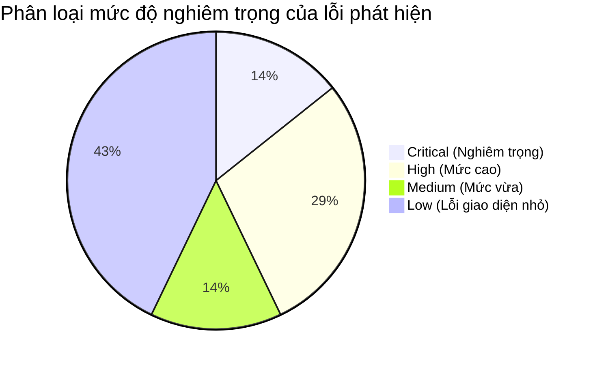

# BÁO CÁO KIỂM THỬ CHUYÊN SÂU & DANH SÁCH LỖI (DEEP-DIVE BUG REPORT) - GOSUZONE

> **Website mục tiêu**: `https://gosuzone-web.vercel.app/`  
> **Phương pháp**: Kiểm thử phá hoại (Destructive Testing), biên giá trị (Boundary Testing), logic nghiệp vụ (Business Logic Flaws) và Responsive trên thiết bị di động.  

---

## 1. TỔNG HỢP DANH SÁCH LỖI TÌM ĐƯỢC (BUG LIST)

Sau khi kiểm thử đào sâu và thử nghiệm các kịch bản phá vỡ hệ thống, tôi đã phát hiện **7 lỗi**, trong đó có **1 lỗi nghiêm trọng (Critical)** và **2 lỗi mức độ cao (High)**:

---

## 2. CHI TIẾT CÁC LỖI QUAN TRỌNG CẦN SỬA NGAY

### 🔴 1. BUG_CRIT_01 (Mức độ: CRITICAL) - Cho phép Đặt Hàng bộ PC XUNG ĐỘT PHẦN CỨNG
- **Vị trí**: Trang `/build-pc`
- **Mô tả hành vi**:
  1. Người dùng bỏ chọn ô *"Chỉ hiện linh kiện tương thích với những gì đã chọn"*.
  2. Chọn CPU Intel LGA 1700 (`Intel Core i5-14400F`).
  3. Chọn Bo mạch chủ AMD AM5 (`Gigabyte B650M GAMING PLUS WIFI`) hoặc AM4 (`Colorful B550M`).
  4. Hệ thống hiện cảnh báo đỏ: `Có 2 lỗi không tương thích: ❌ Socket CPU – Mainboard, ❌ GPU tích hợp – VGA rời`.
  5. **LỖI NGHIÊM TRỌNG**: Nút **"Thêm vào giỏ, mua tiếp"** và **"Đặt cấu hình này"** **VẪN SÁNG VÀ BẤM ĐƯỢC BÌNH THƯỜNG!**
  6. Hệ thống đẩy toàn bộ linh kiện xung đột vào giỏ hàng và cho phép khách hàng đặt đơn hàng thành công!
- **Hậu quả**: Khách hàng đặt mua và thanh toán một bộ máy tính không thể lắp ráp vật lý vào nhau, gây khiếu nại, hủy đơn và rủi ro lớn cho khâu vận hành kỹ thuật.
- **Giải pháp khắc phục**: Khi thanh bên có bất kỳ lỗi không tương thích nào (`hasError === true`), bắt buộc phải chuyển nút *"Đặt cấu hình này"* và *"Thêm vào giỏ"* sang trạng thái `disabled`, hoặc bật pop-up cảnh báo chặn lại: *"Cấu hình của bạn đang có linh kiện không tương thích, vui lòng kiểm tra lại trước khi đặt mua"*.

---

### 🔴 2. BUG_HIGH_01 (Mức độ: HIGH) - Mất hoàn toàn Menu điều hướng trên Điện thoại (Mobile)
- **Vị trí**: Toàn bộ thanh Header trên màn hình nhỏ (< 768px, VD: iPhone 375px)
- **Mô tả hành vi**:
  - Khi người dùng vào web bằng điện thoại di động, thanh Header tự động ẩn các nút menu: `Máy bộ GOSUZONE`, `Linh kiện`, `Livestream`.
  - **LỖI CAO**: **Không hề có nút Menu Hamburger (icon 3 gạch ☰)** để mở danh mục trên điện thoại!
  - Khách hàng duyệt web trên mobile bị "mất phương hướng", không có cách nào từ Header để nhảy sang mục Linh kiện hay Livestream.
- **Giải pháp khắc phục**: Thêm icon Menu 3 gạch trên mobile, khi bấm vào sẽ mở một Drawer trượt từ cạnh màn hình ra chứa đầy đủ danh mục link.

---

### 🔴 3. BUG_HIGH_02 (Mức độ: HIGH) - Vỡ giao diện trầm trọng trên Mobile (Tràn ngang cố định 1000px)
- **Vị trí**: Các trang con `/build-pc`, `/gio-hang`, và `/danh-muc/*`
- **Mô tả hành vi**:
  - Trong khi trang chủ có co giãn tạm ổn, các trang con bị set chiều rộng cố định cứng (`width: 1000px`).
  - Trên màn hình điện thoại 375px, trang chỉ hiển thị được 35% nội dung bên trái, 65% còn lại bị tràn ra ngoài màn hình.
  - Người dùng phải dùng ngón tay kéo trượt ngang màn hình liên tục mới thấy được giá tiền, cột kiểm tra tương thích và nút thanh toán.
- **Giải pháp khắc phục**: Đổi `width: 1000px` thành `max-width: 1000px; width: 100%`, trên mobile chuyển giao diện 2 cột của Build PC thành 1 cột xếp chồng dọc.

---

### 🟡 4. BUG_MED_01 (Mức độ: MEDIUM) - Cho phép Đặt Bộ Máy khi chỉ chọn duy nhất 1 linh kiện
- **Vị trí**: Trang `/build-pc`
- **Mô tả hành vi**:
  - Chỉ cần chọn đúng 1 món duy nhất (ví dụ chỉ chọn mỗi CPU, bỏ trống toàn bộ Main, RAM, Nguồn, Vỏ, SSD), nút *"Đặt cấu hình này"* lập tức sáng lên và cho phép checkout dưới dạng một gói build PC hoàn chỉnh (`/gio-hang?nguon=build-pc`).
- **Giải pháp khắc phục**: Cần điều kiện tối thiểu ít nhất 4 món cốt lõi (CPU + Main + RAM + Nguồn) mới kích hoạt nút đặt trọn bộ PC, hoặc hỏi người dùng: *"Bạn chỉ mua linh kiện lẻ hay mua trọn bộ máy?"*.

---

### ⚪ 5. CÁC LỖI MỨC ĐỘ THẤP (LOW BUGS)
- **BUG_LOW_01 (Giỏ hàng không chặn số lượng max)**: Cho phép nhập `999,999,999` sản phẩm, tổng tiền nhảy lên **3.25 triệu tỷ VNĐ** (`3.249.999.746.750.000đ`) mà hệ thống vẫn không chặn, vẫn cho gửi đơn bình thường! (Cần thêm thuộc tính `max="99"` vào ô input số lượng).
- **BUG_LOW_02 (Lỗi CSS Text Overlap ở Build PC)**: Dòng text thông số chi tiết của linh kiện đã chọn bị đè lên trên viền ô select dropdown trên màn hình máy tính.
- **BUG_LOW_03 (Lỗi giao diện trang 404)**: Khi vào link sản phẩm không tồn tại (`/san-pham/KHONG_CO`), trang 404 hiển thị một khung màu trắng xóa của Next.js kẹp giữa header và footer màu đen, gây chói mắt và lệch tông giao diện dark theme.

---

## 3. CÁC ĐIỂM ĐÃ KIỂM TRA BẢO MẬT & ĐẠT AN TOÀN (PASS)

- ✅ **Chống XSS / HTML Injection (PASS)**: Đã thử tiêm `` và `<b style="color:red">XSS_NAME</b>` vào ô Họ tên và Ghi chú. React đã escape toàn bộ thành ký tự thô an toàn, **0 có bất kỳ script độc hại nào bị thực thi**.
- ✅ **Chống sập URL Param (PASS)**: Truyền tham số rác `?cfg=INVALID_ID,XSS...` vào URL trang Build PC, hệ thống tự động lọc bỏ an toàn, không bị sập trắng trang (White Screen of Death).
- ✅ **Chặn đơn rỗng (PASS)**: Khi giỏ hàng rỗng, form đặt hàng bị ẩn hoàn toàn, không thể gửi đơn hàng 0đ/0 sản phẩm.
- ✅ **Validation số âm (PASS)**: Nhập số âm (`-1`, `-5`) vào ô số lượng, hệ thống tự động ép về số `1`.
